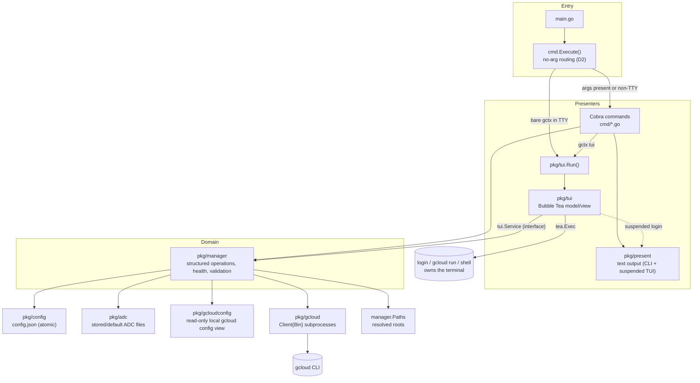
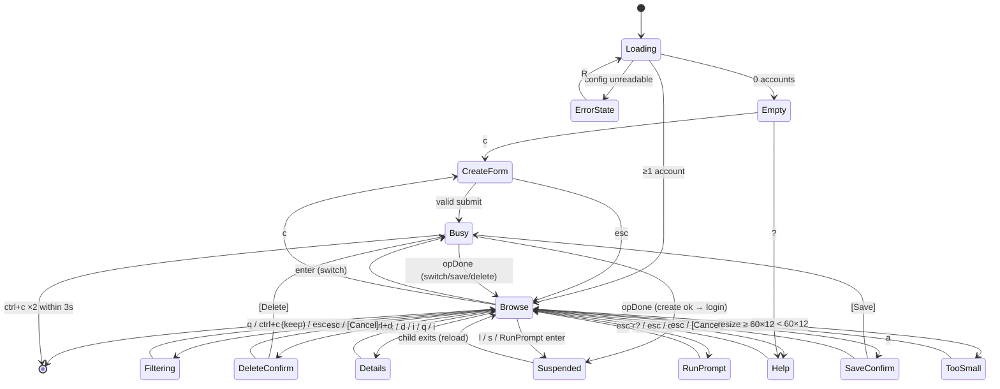

## Context

See `proposal.md` for motivation. The specs define the behavior (`specs/*/spec.md`). This document explains how to build it inside the existing codebase with the smallest maintainable change.

### Repository findings (source is the source of truth)

| Area | Finding | Relevance |
|---|---|---|
| `cmd/*.go` | Thin Cobra commands that call `manager.New()` and one method each. Root has no `Run`, so bare `gctx` prints help (exit 0). `run` uses `DisableFlagParsing`. `completion` supports bash/zsh/fish only. | Routing must not change help bytes. Making root runnable would add a `gctx [flags]` usage line, so routing happens before Cobra dispatch (D2). |
| `main.go` | Prints `Error: %v` after Cobra already printed `Error:` + usage. Errors appear twice on stderr. | Preserved as-is (spec: stable CLI output). Cleanup is a follow-up. |
| `pkg/manager/manager.go` | Every method prints with `fmt.Printf` (≈45 call sites). Errors are swallowed (`config.Save`, `SetActive`, `os.Remove`, `gcloud config configurations delete`, `GetADCEmail`). Uses global state (`os.UserHomeDir`, `PATH` gcloud). | Core refactor target (D6). |
| `manager.CreateAccount` | Creates and activates the gcloud config **before** checking for a duplicate name. No name validation, while the name is used in a file path (`adc/<name>_adc.json`). | Bug fix + validation (account-management spec). |
| `manager.autoSaveFlow` + `watcher.WatchADC` | The watcher snapshots the ADC file *after* `application-default login` returned. It never sees a change and always runs the full 5 s timeout, then accepts any valid file. | Every login wastes 5 s. Snapshot before step 4 instead (D11). |
| `adc.GetADCEmail` | Reads the ADC (unused fields), then runs `gcloud config get-value account` against the **globally active** configuration and swallows errors. | `save X` can record the wrong email. Fix: query X's configuration. |
| `adc.GetDefaultADCPath` | Ignores `CLOUDSDK_CONFIG`. | Fix through a single `Paths` resolver. |
| `manager.DeleteAccount` | Removes `account.ADCPath` (a user-editable value) without bounds. Ignores all errors. Doesn't remove the canonical storage file if `adc_path` was empty. `RestoreADC` uses the canonical path, so a recreated account with the same name would silently get the old credentials. | Credential-safety spec. |
| `manager.RunWithAccount` / `StartShell` | Builds the env inline and runs the child with inherited stdio. Shell resolution inline. Neither sets `CLOUDSDK_ACTIVE_CONFIG_NAME` for account-scoped helper calls. | Return `*exec.Cmd` so CLI runs it and TUI hands it to the suspend mechanism. |
| `manager.SwitchAccount` | `gcloud config set project` inherits the parent `CLOUDSDK_ACTIVE_CONFIG_NAME`. Inside `gctx shell` it sets the project on the shell's configuration. | Fix: target the configuration explicitly. |
| `pkg/config` | Non-atomic `os.WriteFile(0644)`. The whole map is rewritten from memory, so a long-lived process would erase concurrent changes. `ListAccounts` returns map order (random). | Atomic write + re-read before mutate. Sorted listing. |
| `pkg/gcloud` | Package-level funcs hard-code `"gcloud"`, attach `os.Stdin` for interactive calls, have no timeouts, and `parseWarnings` is unused. | Becomes a small `Client` with an injectable binary path. |
| Tests | **None** (`go test ./...` passes vacuously). CI runs only on ubuntu. | Characterization tests first (task group 1). |
| `go.mod` | `go 1.24` (EOL; supported lines are 1.26 and 1.27). `go-fuzzyfinder` is wrongly marked `// indirect` (`go mod tidy -diff` is non-empty). It pulls in `tcell` v2.6 + `termbox-go`. | Bump + tidy (D9). |
| CI / release | Actions pinned by tag, not SHA. No dependabot. Every push to `main` with a `feat:`/`fix:` commit auto-tags a release. GoReleaser builds 6 targets with `CGO_ENABLED=0`. | Every phase merged to `main` ships, so each phase must be releasable (D13). |
| Stale material | `.planning/STATE.md` says Phase 1.2 is pending, but commit `2933985` already shipped it. `Taskfile.yml` `demo:create` still passes the removed `--auto-save`. `mise.toml` pins Go 1.23.12 (below `go.mod`) and uses `latest` for tools. `.planning` is in `.gitignore` but tracked. `readthedocs/docs/architecture.md` omits `login`, `shell`, `version`. README "What's New" is for v0.5.0. | Docs task group fixes the user-facing ones. `.planning` gets a pointer to this change. |

## Goals / Non-Goals

**Goals:**
- One structured, tested domain layer used by both presenters. Existing CLI stdout stays byte-identical except for the explicit list in `specs/cli-commands`.
- A TUI that is thin: state machine + rendering. All decisions about accounts live in `pkg/manager`.
- Hermetic tests for all business logic and TUI behavior, on Linux, macOS, and Windows.
- Every phase independently releasable.

**Non-Goals:**
- GCP API access, resource browsing, token validation over the network, or anything requiring new Google client libraries.
- Daemons, background polling, file watchers, databases, persistent TUI state or history.
- `:` command mode, mouse support, themes or config files for the TUI, replacing the fuzzy-finder pickers, PowerShell completion, or fixing the duplicate `Error:` lines. These are follow-ups (see "Follow-up changes").
- Changing `config.json` or the ADC storage layout.

## Architecture



Dependency rule: `pkg/tui` and `cmd` depend on `pkg/manager` and `pkg/present`. `pkg/manager` depends on `config`, `adc`, `gcloud`, `gcloudconfig`. Nothing in `pkg/manager` imports `pkg/tui`, `pkg/present`, Cobra, or Bubble Tea. `pkg/watcher` is folded into `pkg/adc` (snapshot/compare helpers) and deleted, because its only remaining job is a before/after comparison.

### Package layout after the change

```text
cmd/
  root.go          # Execute(): no-arg routing; registers tui
  tui.go           # `gctx tui [--debug]`
  tty.go           # isInteractive(): x/term + env rules (pure func + thin wrapper)
  ...existing command files (now call manager + present)
pkg/
  manager/
    manager.go     # Manager, Options, Paths, New/NewWithOptions, locking
    status.go      # AccountStatus, Health, Finding, Overview, credential check
    operations.go  # Create, Login, Save, Switch, Delete, Info, Active
    isolate.go     # RunCommand/ShellCommand (*exec.Cmd), ResolveShell
    validate.go    # ValidateAccountName, ValidateProjectID
    results.go     # Warning codes, result structs, StepError
  present/
    text.go        # exact CLI strings; login progress printer
  config/          # + atomic Save, LoadFrom(path), sorted List
  adc/             # + Store{Dir, DefaultPath}, snapshot/compare, bounded remove
  gcloud/          # Client{Bin, Env}: Output (timeout, null stdin), Interactive, Command
  gcloudconfig/    # Dir(), ActiveConfig(), Read(name) -> {Exists, Account, Project}
  tui/
    run.go         # Run(ctx, svc, opts): program setup, debug log, error mapping
    model.go       # Model struct, Init, Update dispatch
    keys.go        # key.Binding table (single source for help + hints)
    view.go        # layout, breakpoints, table, details, header, status line
    modals.go      # create form, delete/save confirm, run prompt
    exec.go        # loginExec/runExec/shellExec (tea.ExecCommand)
    tokenize.go    # run-prompt argv tokenizer + metachar/Windows checks
    styles.go      # lipgloss styles
internal/testutil/
  fakegcloud/      # test-only fake gcloud binary (main package)
  harness.go       # temp HOME/APPDATA/CLOUDSDK_CONFIG + PATH with fake gcloud
```

That is about 9 new non-test files in `pkg/tui`, plus 6 new files for the domain/presenter split. No generic framework, no screen router abstraction.

## Domain API (Phase 1)

Sketch (names are guidance; behavior is fixed by the specs):

```go
type Paths struct {
    GctxDir    string // ~/.config/gctx   (unchanged location on every OS)
    ADCDir     string // <GctxDir>/adc
    GcloudDir  string // $CLOUDSDK_CONFIG | %APPDATA%\gcloud | ~/.config/gcloud
    DefaultADC string // <GcloudDir>/application_default_credentials.json
}

type Options struct {
    Paths    Paths
    Gcloud   *gcloud.Client          // Bin defaults to exec.LookPath("gcloud")
    Getenv   func(string) string     // os.Getenv
    LookPath func(string) (string, error)
    GOOS     string                  // runtime.GOOS
    Now      func() time.Time
}

func New() (*Manager, error)                      // unchanged signature, DefaultOptions()
func NewWithOptions(o Options) (*Manager, error)

func (m *Manager) Overview() (Overview, error)   // local only, < 10ms typical
func (m *Manager) CheckCredentials(ctx context.Context) (CredentialReport, error) // `gcloud auth list --format=json`
func (m *Manager) Info(name string) (AccountStatus, error)
func (m *Manager) ActiveAccount() string         // GCTX_ACCOUNT > config > "unknown"
func (m *Manager) Create(ctx, name, project string) (CreateResult, error)       // stops before login
func (m *Manager) Login(ctx, name string, io LoginIO) (LoginResult, error)      // interactive
func (m *Manager) SaveCredentials(ctx, name string) (SaveResult, error)
func (m *Manager) Switch(ctx, name string) (SwitchResult, error)
func (m *Manager) Delete(ctx, name string, opt DeleteOptions) (DeleteResult, error)
func (m *Manager) RunCommand(name string, args []string) (*exec.Cmd, error)    // not started
func (m *Manager) ShellCommand(name string) (*exec.Cmd, error)                 // not started
func (m *Manager) SelectAccountInteractive() (string, error)                   // unchanged (fuzzyfinder)

type LoginIO struct {
    Stdin io.Reader; Stdout, Stderr io.Writer
    Progress func(LoginEvent) // presenter prints CLI-identical lines from these, in order
}
type Warning struct { Code WarningCode; Account, Message string }
// codes: adc-missing, reauth-required, set-project-failed, config-reused,
// config-delete-failed, adc-path-outside-store, adc-not-refreshed, gcloud-not-found
type StepError struct { Step string; Err error; Stderr string } // Step: "auth login", "application-default login", ...
```

- **Locking:** `Manager` holds a `sync.Mutex`. Every method that reads or writes `config.json` takes it. Every mutating method calls `config.LoadFrom(path)` inside the lock before applying its change (read-modify-write), then saves atomically (`CreateTemp` in the same dir → write → `Sync` → `Close` → `Rename`, preserving `0644`). `CheckCredentials` does not touch the config and takes no lock.
- **CLI presenter:** `cmd/create.go` becomes `res, err := m.Create(...)` → `present.Create(w, res)` → `m.Login(ctx, name, present.LoginIO(os.Stdin, os.Stdout, os.Stderr))` → `present.LoginDone(w, res, err)`. All strings currently in `manager.go` move verbatim into `pkg/present/text.go`. This includes the multi-line ADC-failure hint and the `Watching for ADC file changes...` line (still printed for compatibility, but no longer followed by a 5 s wait).
- **`info`:** `present.Info(w, status)` reproduces the current layout exactly. The new findings are **not** added to `info` output (stable stdout). They are only visible in the TUI.
- **gcloud client:** `Output(ctx, timeout, env, args...)` sets `Stdin=nil` (null device), adds `CLOUDSDK_CORE_DISABLE_PROMPTS=1`, and returns combined output plus a `StepError` carrying the last stderr line. `Interactive(ctx, LoginIO, env, args...)` wires the given stdio. `Command(env, args...)` returns an unstarted `*exec.Cmd` for run.
- **Shell resolution:** `ResolveShell(goos, getenv, lookPath) string` is a pure function with the current preference order.

## Account health model

`pkg/gcloudconfig` provides a read-only local view:
- `Dir(getenv, goos, home)` returns the gcloud configuration directory.
- `ActiveConfig(dir)` reads the `active_config` file. It deliberately ignores `CLOUDSDK_ACTIVE_CONFIG_NAME`, because the header shows global state. A missing file means `default`.
- `Read(dir, name)` checks whether `configurations/config_<name>` exists and parses only `[core] account` and `[core] project` with a minimal line-based INI reader. Unknown sections are ignored. A parse failure produces an `ERROR` finding, never a panic.

`Overview()` builds one `AccountStatus` per account in name order:
1. Stat the stored ADC (canonical path, or `adc_path` if inside `ADCDir`) and `json.Valid` its bytes. The bytes are dropped immediately and never kept in a struct.
2. Read the gcloud configuration.
3. Compute findings, and pick the primary status by the fixed priority from the spec.
4. Compute the default-ADC indicator with `bytes.Equal(defaultADC, activeStoredADC)`. No hash is retained or displayed.

`AUTH REQUIRED` has two sources:
- The credential report from `CheckCredentials` (cached in the `Manager` until the next check), where `core/account` is absent from the `gcloud auth list` output.
- A session set of accounts that returned `reauth-required` from switch, cleared by a successful login.

Cost: one `ReadFile` of `config.json`, about 2 stats/reads per account, and one read of the default ADC. For 50 accounts this is about 100 small file reads, well under the 100 ms budget. Task 4.10 adds a benchmark that guards it.

Why `gcloud auth list` and not a token call: it is local (reads gcloud's credential store), never prints tokens, and never prompts. A real validity check needs network and a token refresh, which can trigger re-auth prompts. That is out of scope (follow-up "network health check" behind an explicit key).

## TUI design

### Model and state

A single Bubble Tea model. Sub-components (`textinput`, `spinner`, `key`, `help`) come from Bubbles. The table is rendered by our own `view.go`, not `bubbles/table`. Our table needs a marker column, per-cell status styling, responsive column sets, and an empty-state body. Doing that inside `bubbles/table` costs more code than about 80 lines of rendering.

```go
type Model struct {
    svc      Service              // narrow interface over *manager.Manager (fakeable)
    exec     func(tea.ExecCommand, tea.ExecCallback) tea.Cmd // tea.Exec; replaced in tests
    version  string

    overview  manager.Overview     // last loaded snapshot (accounts sorted by name)
    loadErr   error                // config.json unreadable → error state
    visible   []int                // indices into overview.Accounts after filter
    selected  string               // selected account NAME (identity survives reloads)
    offset    int                  // first visible row (scrolling)

    screen    screen               // screenMain | screenHelp | screenDetails
    modal     modal                // nil | *createForm | *deleteConfirm | *saveConfirm | *runPrompt
    filter    filterState          // {editing bool; input textinput.Model; query string}

    op        *operation           // in-flight mutating op: {kind, account, seq, started}
    creds     credState            // idle | checking(seq) | done | failed(err)
    seq       int                  // monotonically increasing request id
    quitArmed time.Time            // first ctrl+c during op

    status    statusMsg            // {text, level, expires}
    width, height int
    history   []string             // run prompt, max 50, memory only
}
```

Rules that keep async safe:
1. `Update` is the only place state changes. Background work runs inside `tea.Cmd` functions. These call the service and return a message. They never capture or mutate `Model` fields (they receive copies of the values they need: name, args).
2. Every async request carries `seq`. `Update` drops a result message whose `seq` does not match the current `op.seq`, `creds` seq, or latest reload seq.
3. At most one `op` at a time (spec "Operation concurrency"). Reloads (`Overview`) are fast and synchronous inside `Update`. They are a few ms of local I/O, and keeping them synchronous removes a whole class of races. The credential check is the only concurrent background read.
4. Selection identity is the account **name**. After any reload or filter change, `visible` is rebuilt and the cursor is re-resolved: same name → same row. If the name is gone, the row at `min(oldIndex, len-1)` is used. If the list is empty, there is no selection.

### Messages

`overviewLoadedMsg` is synchronous and so needs no message. The asynchronous messages are:

| Message | Produced by | Effect |
|---|---|---|
| `credsCheckedMsg{seq, report, err}` | credential check cmd | merge auth findings; status `Checking credentials…` cleared |
| `opDoneMsg{seq, kind, result, err}` | switch/save/delete/create cmd | clear `op`, reload, set status from result warnings/err; create → chains to login exec |
| `execDoneMsg{kind, account, result, err}` | ExecCallback of login/run/shell | reload, re-run creds after login, status message |
| `statusExpiredMsg{id}` | `tea.Tick(5s)` | clear info status if id matches |
| `tea.WindowSizeMsg` | runtime | store size; clamp offset |
| `tea.FocusMsg` | runtime (View.ReportFocus) | local reload |
| `tea.KeyPressMsg` | runtime | routed: too-small → modal → filter editing → screen → main bindings |

### State transitions



`Busy` is not a separate screen. It is `op != nil` overlaid on Browse/Filtering/Details/Help (navigation still works). `TooSmall` is derived from `width/height` at render time and gates key handling. It is not stored state. `Empty` is Browse with zero accounts.

### Layout

```text
gctx v0.7.0 │ Active: work (ems-prod) │ gcloud: work-config │ ADC: ✓ active      ← header (1 line)
┌ Accounts ── filter: s (2/3) ──────────────────┐┌ work ───────────────────────────┐
│   NAME      PROJECT       EMAIL       ADC STATUS││ Project   ems-prod             │
│ ● work      ems-prod      w@…         ✓  READY  ││ Email     w@example.com        │
│   sandbox   ems-sandbox   w@…         ✗  ADC MI…││ Config    work-config ✓        │
│                                                ││ gcloud    w@example.com/ems-…  │
│                                                ││ ADC       ~/.config/gctx/adc/… │
│                                                ││ Created   2026-04-01           │
└────────────────────────────────────────────────┘└─────────────────────────────────┘
⠋ Switching to sandbox…                                                 ← status line
enter switch · l login · s shell · r run · c create · ^d delete · / filter · ? help · q quit
```

- Breakpoints are exactly those in the spec. The column width budget is computed per render. `NAME` gets at least 10 columns, and the remaining space is shared between `PROJECT` (≥ 12) and `EMAIL` (≥ 12). `STATUS` is fixed at 16 columns (fits `PROJECT MISMATCH`). `ADC` is 3.
- Visible rows = `height − 6` (header, borders ×2, column header, status, hints). `offset` is clamped so `selected` is visible.
- Modals render centered over the main view (lipgloss `Place`), with width `min(64, width−4)`.
- Styles: a single `styles.go`. Lip Gloss v2 colour downsampling handles 16/256/true-color and honours `NO_COLOR` (colorprofile). Statuses always include text, so monochrome is fully usable.

### Keybinding validation (why the table looks the way it does)

| Proposed | Problem | Resolution |
|---|---|---|
| `d` delete | k9s users press `d` for *describe*. A muscle-memory `d` would open a destructive dialog. | `d` = details (with `i` as an alias). Delete moves to `ctrl+d`, which is k9s's delete key. |
| `Enter` to confirm delete | Fast `ctrl+d`,`enter` would delete instantly. | Default focus is `[Cancel]`. Deleting requires moving focus first. |
| `a` save ADC | Silently copies *whatever* account's credentials sit in the global ADC file. | Confirmation shows the default ADC path, mtime, and the configured email. |
| `r` / `R` | Case-only difference. Both are non-destructive, so a mistake is harmless. | Kept (k9s uses `ctrl+r`, which is often captured by the shell). |
| `q` in help/details | Users expect "close", not "quit app". | `q` closes help/details. It quits only from the main view. |
| `ctrl+c` in forms | Convention conflict: cancel vs quit. | k9s semantics: always quit (guarded during an in-flight op). `esc` is cancel everywhere. |
| letters in filter/inputs | `j`, `k`, `q` must be typeable. | While an input has focus, only `esc`, `enter`, `tab`, arrows, and `ctrl+*` are commands. |
| `:` | Command mode is not in the MVP. | Reserved with an explicit message (D3). |
| `g` / `G` | `G` arrives as text `"G"` in Bubble Tea v2 (`Key.String()`), not `shift+g`. | Bind `"G"` and `"end"`. Unit-test both. |

All bindings are declared once in `keys.go` as `key.Binding`s. The help screen and hint line are generated from that table, so they cannot drift.

### Subprocess lifecycle (suspend/resume)

All three interactive flows use `tea.Exec` with our own `tea.ExecCommand` implementations. Bubble Tea's `exec` releases the terminal: it leaves the alt screen, restores cooked mode, and stops reading input. While the command runs, it sets `ignoreSignals`, so `SIGINT` from `ctrl+c` reaches only the foreground child. Afterwards it restores the terminal and delivers our callback message. Verified in `charm.land/bubbletea/v2@v2.0.10` `exec.go` / `tea.go`.

| Flow | `ExecCommand.Run()` does | Waits for Enter? |
|---|---|---|
| login | prints banner → `svc.Login(ctx, name, LoginIO{stdio, Progress: present.LoginProgress(stdout)})` → stores result | only on failure |
| run | prints `── gctx: running as … ──` → `cmd.Run()` with the given stdio → prints exit line | always (output must be readable) |
| shell | prints banner → `cmd.Run()` | no |

"Wait for Enter" reads one line from the supplied stdin (cooked mode, so Enter or EOF ends it). The result is stored on the `ExecCommand` struct, and the `ExecCallback` closure reads it into `execDoneMsg`. A non-zero exit from `run`/`shell` is a normal outcome (`*exec.ExitError` → exit code), not a TUI error.

Why not capture `run` output into an in-TUI viewport (D5)? gcloud commands can prompt (`Y/n`), page, colour, and stream large output. Capturing breaks all of these, and it would mean keeping arbitrary command output (possibly secrets) in memory and rendering it.

#### Switch sequence

```mermaid
sequenceDiagram
  actor U as User
  participant T as TUI (Update)
  participant C as tea.Cmd goroutine
  participant M as manager.Manager
  participant FS as filesystem
  participant G as gcloud
  U->>T: enter on "sandbox"
  T->>T: op = {switch, sandbox, seq=7}; status "Switching to sandbox…"
  T->>C: return switchCmd(seq 7, "sandbox")
  C->>M: Switch(ctx, "sandbox")
  M->>FS: reload config.json (lock held)
  M->>FS: restore stored ADC → default ADC (tmp+rename)
  alt no stored ADC
    M-->>M: warning adc-missing
  end
  M->>G: config configurations activate sandbox-config (null stdin, 30s)
  M->>G: config set project ems-sandbox (CLOUDSDK_ACTIVE_CONFIG_NAME=sandbox-config, 60s)
  alt "Reauthentication required"
    M-->>M: warning reauth-required; session AUTH REQUIRED
  end
  M->>FS: set active_account=sandbox (atomic)
  M-->>C: SwitchResult{warnings}
  C-->>T: opDoneMsg{seq 7, result}
  T->>T: seq matches → op=nil → Overview() reload → status from warnings
  T-->>U: ● on sandbox, header updated
```

#### Login suspend/resume sequence

```mermaid
sequenceDiagram
  actor U as User
  participant T as TUI
  participant BT as Bubble Tea runtime
  participant L as loginExec.Run
  participant M as manager.Manager
  participant G as gcloud (interactive)
  U->>T: l on "sandbox"
  T->>BT: tea.Exec(loginExec{sandbox}, cb)
  BT->>BT: release terminal (exit alt screen, cooked mode, ignore SIGINT)
  BT->>L: Run() with real stdin/stdout
  L->>M: Login(ctx, sandbox, LoginIO)
  M->>M: snapshot default ADC state
  M->>G: config configurations activate sandbox-config
  M->>G: auth login (CLOUDSDK_ACTIVE_CONFIG_NAME=sandbox-config)
  G-->>U: browser flow
  alt user presses ctrl+c / gcloud fails
    G-->>M: exit ≠ 0
    M-->>L: StepError{auth login}
    L-->>U: prints error + "Press Enter to return to gctx"
    U->>L: Enter
  else success
    M->>G: auth application-default login
    G-->>U: browser flow
    M->>M: verify default ADC (no fixed wait), copy → adc/sandbox_adc.json (0600)
    M->>G: config get-value account (sandbox-config) → email
    M->>M: save config.json (atomic, re-read first)
    M-->>L: LoginResult{warnings}
  end
  L-->>BT: Run() returns
  BT->>BT: restore terminal (alt screen, raw mode, signals)
  BT->>T: execDoneMsg{login, sandbox, result, err}
  T->>T: reload; clear session AUTH REQUIRED on success; start credential check; status
```

### TTY detection and routing (D2)

`cmd.Execute()`:

```go
if len(os.Args) == 1 && tuiDefaultEnabled && shouldLaunchTUI(envLookup, stdinIsTTY, stdoutIsTTY) {
    return runTUI(ctx, debugFromEnv())
}
return rootCmd.Execute()
```

- `shouldLaunchTUI` is a pure function covering the spec's five conditions. It has a table test, including `CI=false`, `CI=0`, and `CI=` (empty).
- TTY checks use `golang.org/x/term.IsTerminal(int(f.Fd()))` for both `os.Stdin` and `os.Stdout`. This works with Windows console handles. MinTTY/MSYS pipes report false, so behavior falls back to help (correct: Bubble Tea cannot drive a MinTTY pipe).
- `tuiDefaultEnabled` is a package-level `const`, `false` until task group 9, so earlier releases keep `gctx` → help everywhere.
- Root stays non-runnable, so `rootCmd.Execute()` output is byte-identical to today, both in the fallback and for `--help`.
- `gctx tui` is a normal Cobra command with `SilenceUsage: true` and `SilenceErrors: true`, so `main` prints the single `Error:` line.

`pkg/tui.Run` creates the program with:
- `tea.WithContext(ctx)`
- default input/output (the real TTY)
- the panic catching left enabled, which restores the terminal before the panic is re-reported as an error

The `View` sets `AltScreen = true` and `ReportFocus = true`, and does not enable mouse capture. On return it maps `tea.ErrProgramKilled`/`ErrInterrupted` to a clean exit and other errors to `interactive UI failed: …`.

### Error model

- Domain errors are Go errors. `StepError{Step, Err, Stderr}` identifies the failing gcloud step. Sentinel errors are `ErrAccountNotFound`, `ErrAccountExists`, `ErrInvalidName`, and `ErrGcloudNotFound` (from `exec.LookPath` at `NewWithOptions`; stored, not fatal). CLI messages keep their current text: `account '%s' not found`, `account '%s' already exists`.
- Warnings are values, not errors (`Warning{Code, Account, Message}`). The CLI presenter prints the historical strings for the historical warnings. New warning codes print to stderr.
- TUI mapping: error → status line, level error, persists. Warning → level warning, persists until the next action. Success → info, 5 s. Validation errors stay inside the modal.
- Fatal TUI errors (cannot start, renderer failure) are returned from `tui.Run` after Bubble Tea has restored the terminal. `cmd` turns them into the `interactive UI failed` message.

### Debug logging

`GCTX_DEBUG=1` or `--debug` opens `os.UserCacheDir()/gctx/tui-debug.log` (`0600`, truncated at startup when > 1 MiB) and passes a `*slog.Logger` to the model. Without debug, a discard handler is used. Log calls exist only at the op boundary (start/end, duration, exit code, account name, gcloud verb). There are no log calls in the domain layer, which keeps credential-adjacent code free of logging. Nothing writes to stdout/stderr while the program runs.

## Testing seams

| Seam | Mechanism | Why not more |
|---|---|---|
| Filesystem roots | `manager.Paths` (and `config.LoadFrom`, `adc.Store`) built from `t.TempDir()` | No FS interface needed; real files on a temp dir are simpler and also test permissions/atomic rename on every OS |
| gcloud | `gcloud.Client{Bin}` points at **`internal/testutil/fakegcloud`**, a small Go `main` built once in `TestMain` (`go build -o $TMP/gcloud[.exe]`) | Exercises the real `exec` path on all three OSes. A Go interface fake would leave subprocess env/stdin/timeouts untested. |
| fake gcloud behavior | Reads `CLOUDSDK_CONFIG` and emulates `configurations create/activate/delete/list`, `config set project`, `config get-value account`, `auth list --format=json`, `auth login`, `auth application-default login` by manipulating files in that dir. Each invocation (argv + `CLOUDSDK_ACTIVE_CONFIG_NAME` + stdin-is-null flag) is appended to `$FAKE_GCLOUD_LOG` (JSONL). Failure injection via `FAKE_GCLOUD_FAIL=<verb>:<exit>[:stderr]`; latency via `FAKE_GCLOUD_SLEEP=<verb>:<ms>`. | One fake serves unit, integration, CLI characterization, and TUI tests |
| harness dirs | The harness sets `CLOUDSDK_CONFIG` to the *same* directory the pre-change code derives from `HOME`/`APPDATA` (`<home>/.config/gcloud`, or `<appdata>/gcloud` on Windows). Characterization tests written against today's code (which ignores `CLOUDSDK_CONFIG`) therefore stay valid after the refactor. | |
| shell | `ResolveShell` is pure. `ShellCommand` returns `*exec.Cmd`, so tests inspect `Path`, `Args`, `Env` without running a shell | No executor interface needed |
| TUI ↔ domain | `tui.Service` interface (the methods the TUI calls), implemented by `*manager.Manager`. Tests use an in-memory fake with scripted results/delays. | The one interface in the design, where a fake is clearly cheaper than a real stack |
| suspend/resume | `Model.exec` field (default `tea.Exec`). Tests substitute a function that runs the `ExecCommand` synchronously against pipes and returns its callback message. | Avoids needing a real TTY for flow tests |
| time | `Model.now func() time.Time` for status expiry and the double-ctrl+c window | |

TUI tests drive `Update` with constructed messages (`tea.KeyPressMsg{Code: 'j', Text: "j"}`, `tea.WindowSizeMsg{…}`). They assert on model fields and on `ansi.Strip(View().Content)` substrings. There are no full-screen golden files, except one small golden per breakpoint (60/90/120 columns, stripped of ANSI) to catch layout regressions. Any returned `tea.Cmd` is executed inline by a test helper (`drain(m, cmd)`), which recursively feeds messages back until quiescent. `teatest` is not used: it is published only as pseudo-versions under `x/exp` (supply-chain policy prefers tagged releases), and the direct `Update` approach covers the same ground.

The full matrix, E2E scenarios, and manual verification list are in `test-plan.md`.

## Cross-platform concerns

- **Windows consoles:** Bubble Tea v2 drives Windows Terminal and conhost via `x/windows`/VT mode. `ExecProcess` hands the console to children correctly. Ctrl+C in a console is delivered to every process attached to it. Bubble Tea ignores it while exec'ing, and the child handles it. **Manual verification required** (no automated console in CI): PowerShell 7, Windows PowerShell 5.1, cmd.exe, under Windows Terminal and conhost.
- **MinTTY (Git Bash) without winpty:** stdin/stdout are pipes, so bare `gctx` → help and `gctx tui` → error with the winpty / Windows Terminal hint. Documented in troubleshooting.
- **`gcloud` on Windows is `gcloud.cmd`:** Go's `exec` runs `.cmd` through `cmd.exe`, which reinterprets `& | < > ^ % !`. The TUI run prompt rejects those characters when `filepath.Ext(gcloudBin)` is `.cmd`/`.bat` (credential-safety spec). CLI `run` keeps current behavior. Fake gcloud on Windows is built as `gcloud.exe` and is found before `gcloud.cmd` by `PATHEXT` ordering in tests. A separate test asserts the `.cmd` rejection by setting `Client.Bin` to a `gcloud.cmd` path.
- **`SHELL` on Windows:** Git Bash sets `SHELL=/usr/bin/bash`. The current code honors it, and exec then fails because it is not a Windows path. Preserve the current precedence (spec), but when `exec.LookPath(SHELL)` fails on Windows, fall back to the Windows chain. That fallback is new but only replaces a guaranteed failure.
- **Paths:** `~/.config/gctx` on all OSes (unchanged). The gcloud dir follows gcloud's own rules.
- **Line endings / widths:** rendering uses `lipgloss.Width` (grapheme-aware). Status glyphs `●✓✗⚠…` are single-width in all supported terminals. Under `TERM=linux` (no Unicode font), a `GCTX_ASCII=1` env switches to `* + x ! ...`. This is a cheap escape hatch, documented in troubleshooting.

## Decisions

### D1 — TUI library: Bubble Tea v2 + Bubbles v2 + Lip Gloss v2
- **Alternatives:**
  - **tview** (v0.42.0, Aug 2025, on tcell). It has built-in Table/Form/Modal and `Application.Suspend`. It would reuse tcell, which is already in the graph via go-fuzzyfinder (needs an upgrade from 2.6 to ≥ 2.8). But it is retained-mode: widget state lives inside widget objects mutated by callbacks, which makes the state machine hard to unit-test. Tests need `tcell.SimulationScreen` and screen scraping. Releases are infrequent; master is consumed via pseudo-versions in practice.
  - **raw tcell:** we would hand-write layout, input fields, focus, and suspend/resume. Most code, least leverage.
- **Reason:** Elm-style `Update(msg) → (model, cmd)` makes every spec scenario a deterministic unit test without a terminal. `tea.Exec` gives correct suspend/resume with signal hand-off, verified in source. It has the largest active Go TUI ecosystem and regular tagged releases (bubbletea v2.0.0 Feb 2026 → v2.0.10 Sep 2026). Cross-platform rendering, including Windows, is maintained upstream. The forms we need are two text inputs and two confirm dialogs, which is small with `bubbles/textinput`.
- **Consequences:** about 20 new modules (ultraviolet, x/ansi, x/term, x/windows, colorprofile, displaywidth, uax29, cancelreader…). `go 1.26.0` is required by bubbletea v2.0.10 (D9). k9s itself uses tview. We consciously diverge, because testability matters more here than visual parity.

### D2 — Bare `gctx` opens the TUI (gated), plus explicit `gctx tui`
- **Alternatives:** `gctx tui` only (zero compatibility risk, worse discoverability). Bare `gctx` always opens the TUI (breaks pipes/CI and hangs scripts).
- **Reason:** the product goal is "type `gctx`". The five-condition gate guarantees every non-interactive invocation sees today's exact help. `GCTX_NO_TUI=1` is the opt-out for humans. Routing before Cobra keeps help bytes identical.
- **Consequences:** interactive users who typed `gctx` for help now get the TUI. This is announced in release notes and README, and `--help` is unchanged. The routing is enabled only in the final phase (`tuiDefaultEnabled` const).

### D3 — `:` command mode deferred
- **Alternatives:** ship `:accounts`, `:create`, … in the MVP.
- **Reason:** gctx has a single resource type, and every command already has a single key. Command mode adds a parser, completion, and help for no new capability. `:` is reserved so adding it later is not a breaking change.
- **Consequences:** a follow-up change adds it if users ask (natural fit: `:ctx <name>` quick switch with completion).

### D4 — Health: local-first synchronous, credential check async, no network
- **Alternatives:** call gcloud for every row at startup (seconds of latency, since gcloud's Python startup is about 0.5–1.5 s per call). Token validation (network, can prompt).
- **Reason:** the 100 ms startup target. Never trigger auth by looking.
- **Consequences:** `AUTH REQUIRED` can be a false negative (expired refresh token with a still-listed credential). It becomes accurate after the first failing operation in the session. A network check can be added as an explicit action later.

### D5 — Run/shell/login suspend the TUI; no captured output view
See "Subprocess lifecycle". Consequence: run output is not scrollable inside the TUI. The user reads it in the terminal before pressing Enter.

### D6 — Refactor size: restructure inside existing packages, one interface
- **Alternatives:** a new `pkg/account` service package with repository/runner/storage interfaces. Or leaving `manager` as-is and having the TUI call the printing methods (rejected by requirement: no output parsing).
- **Reason:** the codebase is about 900 lines. Methods move from "print" to "return result". Seams are concrete values (paths, binary path), not interfaces. The only interface is `tui.Service`.
- **Consequences:** `manager.New()` keeps its signature. `cmd` grows by about the size of the moved print statements.

### D7 — Delete: ADC always removed, gcloud configuration opt-in
- **Alternatives:** an optional "remove saved ADC" checkbox, as in the initial wireframe.
- **Reason:** CLI semantics already always remove ADC. Keeping it would leave a credential file that a future account with the same name silently inherits (`RestoreADC` uses the canonical path). There is no user benefit to keeping orphaned credentials.
- **Consequences:** the dialog shows a fixed notice instead of a checkbox.

### D8 — Filtering: native case-insensitive substring; keep go-fuzzyfinder for legacy pickers
- **Alternatives:** reuse go-fuzzyfinder inside the TUI (impossible: it owns the terminal). `sahilm/fuzzy` (already a transitive dependency of bubbles) for fuzzy ranking. Replace the legacy pickers now.
- **Reason:** account lists are short. Substring is predictable and needs no ranking UI. Replacing the CLI pickers changes `switch`/`shell` UX and is unrelated to the TUI's success.
- **Consequences:** two terminal stacks (tcell via fuzzyfinder + Bubble Tea) ship in one binary until the follow-up "replace fuzzyfinder picker with a Bubble Tea picker" change. That follow-up removes tcell, termbox-go, and go-fuzzyfinder.

### D9 — Toolchain: `go 1.26.0`, toolchain pinned to a vetted 1.26 patch
- **Alternatives:** stay on Go 1.24 with bubbletea v2.0.2 (Mar 2026, `go 1.24.2`). This misses 8 bug-fix releases, and 1.24 no longer receives security fixes.
- **Reason:** 1.24 and 1.25 are EOL (current: 1.27.1, 1.26.8). 1.26 is the oldest supported line and is what bubbletea ≥ v2.0.10 requires.
- **Consequences:** building from source needs Go ≥ 1.26 (auto-downloaded under the default `GOTOOLCHAIN=auto`). Release binaries are unaffected for users. `mise.toml` and the CI `go-version-file` follow `go.mod`.

**Pinned versions (all released ≥ 7 days before 2026-10-06; re-verify at implementation time with `curl -s https://proxy.golang.org/<module>/@v/<ver>.info`):**

| Module | Version | Released |
|---|---|---|
| charm.land/bubbletea/v2 | v2.0.10 | 2026-09-24 |
| charm.land/bubbles/v2 | v2.2.1 | 2026-08-24 |
| charm.land/lipgloss/v2 | v2.0.6 | 2026-08-11 |
| golang.org/x/term | v0.46.0 | 2026-09-08 (promote to direct) |
| github.com/creack/pty (test-only, `!windows`) | v1.1.24 | 2024-10-31 |
| Go toolchain | go1.26.8 (or newest 1.26.x ≥ 7 days old) | — |

If a newer patch exists at implementation time and is ≥ 7 days old, prefer it. Never take a release younger than 7 days unless it is a documented CVE fix.

### D10 — Alternate screen on, mouse off
- **Reason:** k9s-like full screen. It restores the user's scrollback on exit. Mouse capture would break terminal-native text selection, which people use to copy project IDs.

### D11 — Login ADC verification: snapshot-before, no polling
- **Alternatives:** keep `WatchADC` polling (always 5 s), or remove verification.
- **Reason:** gcloud has finished writing when `application-default login` exits. Comparing a pre-step snapshot gives the same signal with no wait.
- **Consequences:** `pkg/watcher` is removed. The `Watching for ADC file changes...` line is still printed by the presenter for output stability.

### D12 — Config consistency without locks
- **Alternatives:** advisory file locks (platform-specific: flock vs LockFileEx), or a daemon (excluded).
- **Reason:** gctx operations are human-paced. Re-read-before-write + atomic rename reduces lost updates to a sub-millisecond window and makes torn writes impossible.
- **Consequences:** two truly simultaneous mutations can still race (last writer wins on the whole document). This is documented as a known limitation.

### D13 — Release in phases, each releasable from `main`
Auto-release tags on every `feat:`/`fix:` push, so each task group must leave `main` shippable:

| Phase (task groups) | Ships | User-visible |
|---|---|---|
| 0 Baseline (1) | characterization tests, fake gcloud, toolchain bump, CI matrix, dependabot | nothing |
| 1 Domain split (2–3) | structured manager + presenter + bug fixes | CLI fixes only (spec-listed) |
| 2 Read-only TUI (4) | `gctx tui`: browse, filter, details, help, health, resize | new command (help text says "experimental") |
| 3 Mutations (5) | switch, save, delete | |
| 4 Subprocess flows (6–7) | login, create, run, shell | |
| 5 Hardening + default (8–10) | debug log, Windows verification, docs, `tuiDefaultEnabled = true`, drop "experimental" | bare `gctx` opens TUI |

Commit types: phases 0–1 use `test:`/`refactor:`/`fix:`/`ci:`/`build:` (patch bumps). The phase 2 commit adding `gctx tui` is `feat:` (minor bump). The phase 5 routing commit is `feat:` with a release-note paragraph about bare `gctx`.

## Risks / Trade-offs

- [Refactor silently changes CLI output] → Characterization tests are written against the **current** binary before any refactor (task group 1). They byte-compare stdout and assert exit codes for every command, and they must pass unchanged after each refactor task (except tests updated for the spec-listed changes, each in its own commit).
- [Terminal left in raw/alt mode on Windows after a crash] → Rely on Bubble Tea's restore-on-panic/exit. Never `os.Exit` inside the TUI. Manual matrix in `test-plan.md`. Troubleshooting doc gives `reset` / reopen-tab guidance.
- [Subprocess inherits the alt screen or broken echo] → `tea.Exec` releases the terminal first. Covered by a manual check per OS.
- [Dependency footprint and binary size (+2–4 MB)] → Accepted (D1). The follow-up removal of fuzzyfinder/tcell recovers some.
- [Go 1.26 minimum breaks `go install` for users pinned to old Go with `GOTOOLCHAIN=local`] → Release note. Homebrew/Scoop/binaries are unaffected.
- [Local gcloud config parsing depends on gcloud's on-disk layout] → The layout (`configurations/config_<name>` INI, `active_config`) has been stable for years. The parser is tolerant: unknown → `ERROR` finding with a message, never a crash. Mutations still go through the gcloud CLI.
- [`AUTH REQUIRED` false negatives] → D4. The details view says "credentials present (not validated online)".
- [Global ADC is overwritten by login of a non-active account] → This is existing `gctx login` semantics, kept. The header's `ADC: ⚠ differs` and `gcloud: … ⚠` make it visible, and `enter` on the active account re-syncs. Follow-up: isolate login so global state is untouched.
- [Concurrent mutation race] → D12, documented.
- [Accidental `enter` switches the global context] → Reversible, shown immediately in the header. Not guarded by a dialog, to keep the primary action fast.

## Migration Plan

1. No data migration: `config.json` and ADC storage are unchanged. Old binaries keep working on files written by the new one, and vice versa.
2. Release phases per D13. Each phase is a normal auto-released version.
3. **Rollback:** any phase can be reverted with `git revert` of its commits. Phases 2–4 are additive (`gctx tui` only). For phase 5, users can also set `GCTX_NO_TUI=1`, and maintainers can flip `tuiDefaultEnabled` back to `false` in a patch release without removing the TUI.
4. Docs, README "What's new", and release notes are part of phase 5. `.planning/ROADMAP.md` and `STATE.md` get a pointer to this OpenSpec change, marking phase 1.2 complete (stale).

## Follow-up changes (explicitly out of scope)

- `add-tui-command-mode` (`:` commands with completion).
- `replace-fuzzyfinder-picker` (Bubble Tea picker for `switch`/`shell` without args; drop tcell/termbox/go-fuzzyfinder).
- `isolate-login-global-state` (login without touching the global gcloud config or ADC).
- `network-health-check` (explicit key to validate tokens online).
- `cli-error-output-cleanup` (single `Error:` line), `powershell-completion`.
- asciinema/GIF demo of the TUI for README.

## Open Questions

None that block implementation. Exact colours are left to `styles.go`, constrained by the spec (text conveys status; `NO_COLOR` honoured).
