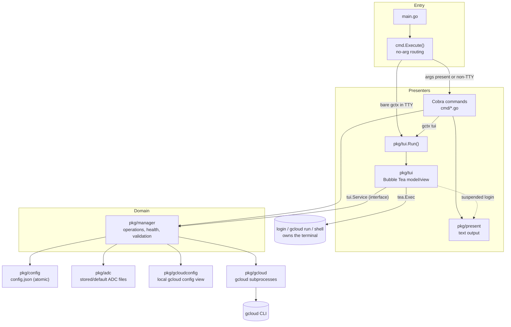

# Architecture

This document describes the internal architecture of `gctx`.

## Directory Structure

```text
cmd/
  root.go          # Execute(): no-argument routing; registers tui
  tui.go           # gctx tui [--debug]
  tty.go           # terminal detection and launch rules
  ...              # existing command files (call manager + present)
pkg/
  manager/
    manager.go     # Manager, Options, Paths
    status.go      # account health and overview
    operations.go  # create, login, save, switch, delete, info, active
    isolate.go     # run and shell commands, shell resolution
    validate.go    # account name and project validation
    results.go     # warnings, result structs, StepError
  provider/
    provider.go    # Provider contract, Runner, shared result types
    registry.go    # provider registry
    gcp/           # GCP provider over gcloud, adc and gcloudconfig
  present/
    text.go        # CLI text output and login progress
  config/          # config.json (atomic save, sorted listing)
  adc/             # stored and default ADC files, snapshot/compare
  gcloud/          # gcloud subprocess client
  gcloudconfig/    # read-only view of local gcloud configuration
  tui/
    run.go         # program setup, debug log, error mapping
    model.go       # model, Init, Update
    keys.go        # keybinding table (drives help and hints)
    view.go        # layout, table, details, header, status line
    modals.go      # create, delete, save and run dialogs
    exec.go        # login/run/shell subprocess hand-off
    tokenize.go    # run-prompt tokenizer and safety checks
    styles.go      # styles
internal/testutil/
  fakegcloud/      # fake gcloud binary for tests
  harness.go       # isolated HOME and gcloud config for tests
main.go
```

## Overview



`pkg/tui` and `cmd` depend on `pkg/manager` and `pkg/present`. `pkg/manager` owns `config.json` and session state and delegates cloud-specific work to a provider (`pkg/provider`); the GCP provider (`pkg/provider/gcp`) wraps `adc`, `gcloud` and `gcloudconfig`. `pkg/manager` never depends on the TUI, presenters, Cobra or Bubble Tea. See the [TUI guide](tui.md) for behavior.

## Core Components

### 1. Configuration Management (`pkg/config`)

**Purpose**: Store and manage account metadata

**Storage Location**: `~/.config/gctx/config.json`

**Structure**:
```go
type Config struct {
    Accounts      map[string]*Account `json:"accounts"`
    ActiveAccount string              `json:"active_account,omitempty"`
}

type Account struct {
    Name       string    `json:"name"`
    ConfigName string    `json:"config_name"`
    ProjectID  string    `json:"project_id"`
    ADCPath    string    `json:"adc_path"`
    CreatedAt  time.Time `json:"created_at"`
    Email      string    `json:"email,omitempty"`
}
```

### 2. ADC Management (`pkg/adc`)

**Purpose**: Handle Application Default Credentials file operations

**Storage**: `~/.config/gctx/adc/`

**Key Functions**:
*   `SaveADC(accountName)`: Copies the default ADC file to the account's storage path.
*   `RestoreADC(accountName)`: Restores the saved ADC file to the default location.
*   `ValidateADC(path)`: Ensures the ADC file is valid JSON before saving/restoring.

### 3. GCloud Integration (`pkg/gcloud`)

**Purpose**: Wrapper around `gcloud` CLI commands

**Key Functions**:
*   `CreateConfig(configName)`: Creates a new gcloud configuration.
*   `ActivateConfig(configName)`: Switches the active gcloud configuration.
*   `SetProject(projectID)`: Sets the project for the current configuration.
*   `AuthLogin()`: Runs `gcloud auth login`.
*   `AuthADCLogin()`: Runs `gcloud auth application-default login`.

### 4. Manager (`pkg/manager`)

**Purpose**: High-level orchestration that ties everything together.

**Key Workflows**:
*   **CreateAccount**: Creates gcloud config, sets project, and optionally triggers auto-save.
*   **SwitchAccount**: Restores the account's ADC file and activates its gcloud config.
*   **Login**: Runs auth commands, compares the default ADC before and after, and saves the new credentials.

## Security Considerations

1.  **File Permissions**: ADC files are stored with restricted permissions (usually 0600) to prevent unauthorized access.
2.  **Atomic Operations**: File operations (like restoring ADC) use temporary files and atomic renames where possible to prevent corruption.
3.  **Validation**: ADC files are validated as JSON before being processed.
