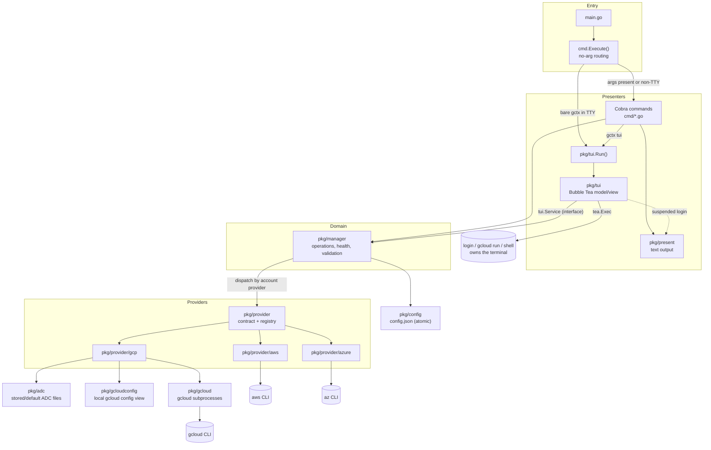

# Architecture

This document describes the internal architecture of `gctx`.

## Directory Structure

```text
cmd/
  root.go          # Execute(): no-argument routing; registers tui
  tui.go           # gctx tui [--debug]
  tty.go           # terminal detection and launch rules
  ...              # existing command files (call manager + present)
pkg/
  manager/
    manager.go     # Manager, Options, Paths
    status.go      # account health and overview
    operations.go  # create, login, save, switch, delete, info, active
    isolate.go     # run and shell commands, shell resolution
    validate.go    # account name and project validation
    results.go     # warnings, result structs, StepError
  provider/
    provider.go    # Provider contract, Runner, shared result types, health
    optional.go    # optional capabilities (EnvBased, CredentialSaver, ...)
    registry.go    # provider registry
    gcp/           # GCP provider over gcloud, adc and gcloudconfig
    aws/           # AWS provider over the aws CLI
    azure/         # Azure provider over the az CLI, isolated config dirs
    providerutil/  # helpers shared by aws and azure
    execrunner/    # subprocess Runner
  secretref/       # parses and resolves key references (op://, gcpsm://, keychain:, env:); not wired to a provider yet
  present/
    text.go        # CLI text output and login progress
  config/          # config.json (atomic save, sorted listing)
  adc/             # stored and default ADC files, snapshot/compare
  gcloud/          # gcloud subprocess client
  gcloudconfig/    # read-only view of local gcloud configuration
  tui/
    run.go         # program setup, debug log, error mapping
    model.go       # model, Init, Update
    keys.go        # keybinding table (drives help, hints and palette)
    layout.go      # width tiers and column priorities
    palette.go     # command palette
    login_screen.go, login_queue.go  # device-code login and stale-login queue
    firstrun.go, offline.go          # first-run import and offline states
    view.go        # layout, table, details, header, status line
    modals.go      # create, delete, save and run dialogs
    exec.go        # login/run/shell subprocess hand-off
    tokenize.go    # run-prompt tokenizer and safety checks
    styles.go      # styles
internal/testutil/
  fakegcloud/      # fake gcloud binary for tests
  harness.go       # isolated HOME and gcloud config for tests
main.go
```

## Overview



`pkg/tui` and `cmd` depend on `pkg/manager` and `pkg/present`. `pkg/manager` owns `config.json` and session state and dispatches each account operation to the provider named by the account (`pkg/provider` registry; accounts without a provider are GCP). The GCP provider (`pkg/provider/gcp`) wraps `adc`, `gcloud` and `gcloudconfig`; GCP-only details (stored ADC, gcloud configuration, `save`, default-ADC comparison) reach the manager through optional interfaces in `pkg/provider`. Credential checks run per provider in parallel, each under its own timeout; the TUI starts one `CheckProviderCredentials` per provider so its status line updates as each finishes, and renders badges, slots, tabs and provider columns from `ProviderInfo` metadata only. `pkg/manager` never depends on the TUI, presenters, Cobra or Bubble Tea. See the [TUI guide](tui.md) for behavior.

## Core Components

### 1. Configuration Management (`pkg/config`)

**Purpose**: Store and manage account metadata

**Storage Location**: `~/.config/gctx/config.json`

**Structure**:
```go
type Config struct {
    Accounts      map[string]*Account `json:"accounts"`
    ActiveAccount string              `json:"active_account,omitempty"`
    // ActiveBySlot maps a provider slot to its active account.
    ActiveBySlot map[string]string `json:"active_by_slot,omitempty"`
}

type Account struct {
    Name       string    `json:"name"`
    ConfigName string    `json:"config_name"`
    ProjectID  string    `json:"project_id"`
    ADCPath    string    `json:"adc_path"`
    CreatedAt  time.Time `json:"created_at"`
    Email      string    `json:"email,omitempty"`
    Provider   string    `json:"provider,omitempty"` // empty means gcp
    // Settings holds provider fields (region, tenant, ...); never secrets.
    Settings   map[string]string `json:"settings,omitempty"`
}
```

New fields are optional, so older config files load unchanged.

### Provider layer and registry (`pkg/provider`)

A provider implements the `Provider` contract (create, login, activate, delete, local status, credential check, metadata for badge, category, slot and columns). The registry holds the registered providers in display order and the manager dispatches by `Account.Provider`. Capabilities only some providers have (stored ADC, `save`, env variables, global state) are optional interfaces checked at the call site.

### Status cache

The manager writes the last credential check per account to `status.json` in the user cache directory: health, identity, expiry and check time, never tokens or keys. The TUI reads it for the first paint and keeps it for `UNVERIFIED` rows when a check fails.

### Slots

`Config.ActiveBySlot` keeps one active account per provider slot. The GCP slot is stored in `active_account` only, so an older binary still reads it.

### 2. ADC Management (`pkg/adc`)

**Purpose**: Handle Application Default Credentials file operations

**Storage**: `~/.config/gctx/adc/`

**Key Functions**:
*   `SaveADC(accountName)`: Copies the default ADC file to the account's storage path.
*   `RestoreADC(accountName)`: Restores the saved ADC file to the default location.
*   `ValidateADC(path)`: Ensures the ADC file is valid JSON before saving/restoring.

### 3. GCloud Integration (`pkg/gcloud`)

**Purpose**: Wrapper around `gcloud` CLI commands

**Key Functions**:
*   `CreateConfig(configName)`: Creates a new gcloud configuration.
*   `ActivateConfig(configName)`: Switches the active gcloud configuration.
*   `SetProject(projectID)`: Sets the project for the current configuration.
*   `AuthLogin()`: Runs `gcloud auth login`.
*   `AuthADCLogin()`: Runs `gcloud auth application-default login`.

### 4. Manager (`pkg/manager`)

**Purpose**: High-level orchestration that ties everything together.

**Key Workflows**:
*   **CreateAccount**: Creates gcloud config, sets project, and optionally triggers auto-save.
*   **SwitchAccount**: Restores the account's ADC file and activates its gcloud config.
*   **Login**: Runs auth commands, compares the default ADC before and after, and saves the new credentials.

## Security Considerations

1.  **File Permissions**: ADC files are stored with restricted permissions (usually 0600) to prevent unauthorized access.
2.  **Atomic Operations**: File operations (like restoring ADC) use temporary files and atomic renames where possible to prevent corruption.
3.  **Validation**: ADC files are validated as JSON before being processed.
